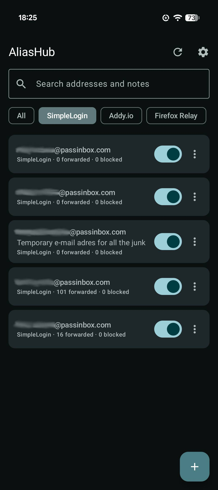
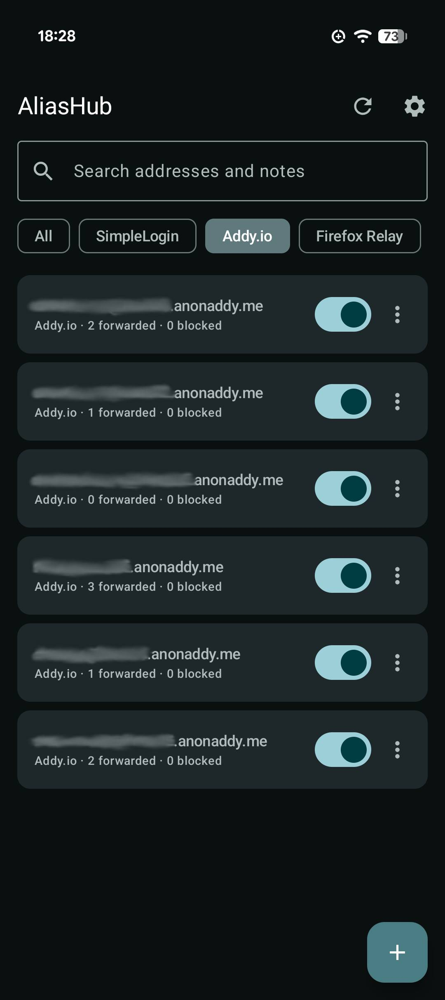
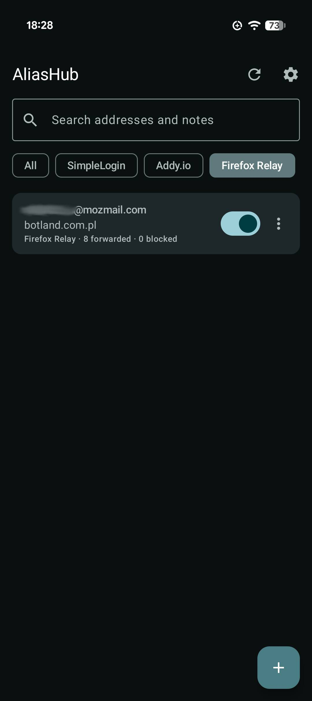

# AliasHub

**All your email aliases. One app.**

AliasHub is an Android app that brings your email aliases from **SimpleLogin**, **Addy.io** and **Firefox Relay** together in one place. Search, create and manage your aliases without switching between apps or websites.

  
  
  

  SimpleLogin · Addy.io · Firefox Relay

## Features

- **One unified list** — browse aliases from all connected providers.
- **Quick search** — find the alias you need.
- **Alias management** — enable, disable, copy, edit notes and delete aliases.
- **Create aliases** — choose a provider and select from the domains available to your account.
- **Multiple providers** — connect any combination of supported services.
- **Self-hosted instances** — configure custom URLs for SimpleLogin and Addy.io.
- **Account overview** — plan, limits and usage for each connected provider, showing only what that service's API reports.
- **System font** — follows the device font by default; switch it off in Settings to use the app's own.
- **Encrypted credentials** — API keys are stored encrypted on your device.
- **Independent integrations** — an issue with one provider won't prevent the others from loading.

## Getting started

### Requirements

- Android 8.0 (API 26) or newer
- An account with at least one supported provider
- An API key for the selected provider

### Build and run

1. Clone or download this repository.
2. Open the `AliasHub` project folder in Android Studio (Ladybug or newer).
3. Sync the Gradle project.
4. Run the app on an Android device or emulator.

### Connect your accounts

On first launch, select **Connect a provider** and enter your API key.

| Provider | Where to find your API key |
|---|---|
| SimpleLogin | Settings → API Keys on [app.simplelogin.io](https://app.simplelogin.io) |
| Addy.io | Settings → API on [app.addy.io](https://app.addy.io) |
| Firefox Relay | Your account settings on [relay.firefox.com](https://relay.firefox.com) |

For self-hosted SimpleLogin or Addy.io instances, enter your instance URL when connecting.

### Manage your aliases

- Tap an alias to copy its email address.
- Use the switch to enable or disable an alias.
- Open the **⋮** menu to edit its note or delete it.
- Tap **+** to create an alias with your chosen provider.

Available domains and suffixes are fetched from your account where supported. Some options depend on your subscription plan.

## Privacy and security

- API keys are stored encrypted on the device.
- Credentials are sent only over HTTPS.
- Android automatic backups are disabled to avoid backing up sensitive app data.
- Each provider is handled independently, so a failure in one integration does not necessarily affect the others.

Your accounts remain subject to the terms and privacy policies of their respective providers.

## Known limitations

- Firefox Relay uses an API employed by its web application that is not officially documented for third-party developers. Compatibility may change without notice.
- Some features, such as SimpleLogin contacts, custom domains and Relay alias creation limits, depend on your account or subscription.

## AI disclosure

**AliasHub is a heavily AI-assisted project.**

The code was written with substantial help from Claude. Although the app has been tested, it may still contain bugs or unexpected behavior.
Found a bug or have an idea for another provider? Feel free to [open an issue](https://github.com/DawidGGs365) on GitHub. I'll do my best to investigate and fix reported problems.

## License

AliasHub is released under the [MIT License](LICENSE).